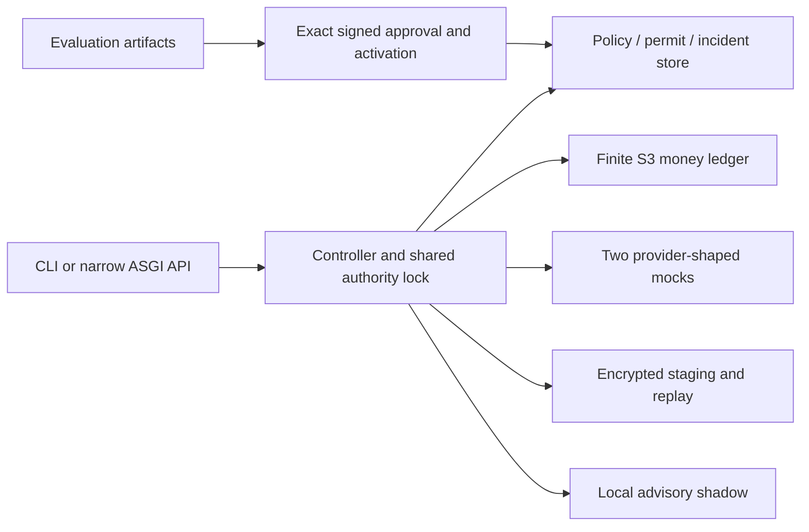

# Governed Gateway

A local, narrow chat gateway source project for finite-budget accounting and evaluated policy changes. Current scope uses two provider-shaped deterministic mocks, a durable S3 ledger closure, a policy journal, encrypted replay, and advisory shadow routing.

**Source construction only; runtime unverified.** No dependency installation, application execution, tests, build, database operation, signing, or provider call was performed during this delivery. Owned components and the final bootstrap candidate passed bounded nonauthoring static child reviews. There are no measured runtime safety, quality, cost, or latency results. External mode is disabled and real provider transports are not implemented in this scope.

## Constructed source

- A bounded authenticated ASGI `POST /v1/chat/completions` subset: text messages, route aliases, explicit output caps, nonstreaming single choice, and closed unsupported/error outcomes.
- OpenAI Chat Completions-shaped and Anthropic Messages-shaped serializers, response normalization, and synthetic success/fault scenarios. Missing or ambiguous billed usage stays unknown; only the proven synthetic pre-send fault has explicit zero usage.
- A pinned, MIT-licensed S3 accounting closure with whole-plan funding, single-use attempt claims, known/unknown settlement, immutable authority configuration, and full exposure reporting. See [vendored provenance](src/gateway/shared/s3/VENDORED.md).
- Exact signed evaluation/approval tuples, evaluated genesis, generation CAS activation/rollback, current eligibility checks, durable stop/incident state, and monotone late-evidence handling.
- AES-GCM staged response replay, permanent idempotency tombstones, fixed terminal retention, and explicit recovery/cancellation source paths. The policy database and money ledger remain separate authorities joined by immutable digests and the shared local lock.
- Zero-call deterministic shadow recommendations, 60 synthetic development tasks, B0/B1/C plus offline scoring/reporting, visible missing/unknown/partial costs, and complete observed-artifact attachment.



SQLite/WAL and runtime secrets belong on an explicitly selected local nonsynced directory outside this repository, OneDrive, and chat exports. Hashes establish identity; they do not prove execution, human participation, valid live billing bounds, or security against a trusted host administrator.

## Intended no-key entrypoint

The concrete source entrypoint is:

```text
python -m gateway.bootstrap --config <absolute-nonsecret-simulation.json> --initialize
```

Follow [the bootstrap recipe](docs/bootstrap.md), including the fixed example lifetime, existing nonsynced runtime root, explicit environment binding, synthetic price/authorization model, and fresh-store restrictions. The source example expires on 2026-10-26; expiry is refused rather than silently renewed. Its in-memory simulation identities are not a persistent restart/key-custody solution. Do not run this command while the current source-only Dirty Mode restriction remains open.

After an authorized activation phase, first resolve/review a lock with `uv lock`, then install with `uv sync --frozen`. No lock, installation, import compatibility, or successful demo execution is claimed now. Dependencies declared in [pyproject.toml](pyproject.toml) are Pydantic 2.12.5 and cryptography 46.0.3. The CLI invokes actual producers and only signs an observed eligible simulation result; no passing evaluation, active policy, or approval is seeded.

## Accounting and evidence limits

Admission uses known spend plus future holds, active holds, unknown liabilities, and uncovered late excess. Direct over-bound charges remain unclamped and halt further admission. Unknown settlements are not refunds. Policy changes never reset the ledger, and a consumed attempt ticket never becomes a replayable send right.

The demo separates cumulative signed evaluation work permissions from the one ledger's actual enforced financial ceiling; those permissions are not extra wallets. All sample prices and model identities are synthetic. Constant mock responses can score zero task quality. Compatibility evidence and measured benefit remain separate; developer-owned observations are not independent acceptance.

Full M8 remains incomplete without actual two-provider transport/billing evidence, tighter evidenced complete-request liability bounds, independent 120-case holdout custody/oracle work, and a separate nonauthoring acceptance reviewer. Future aggregate USD30 allocation is USD1 development / USD24 acceptance / USD5 reserve; it authorizes no current spend or key request. Live acceptance remains blocked, and the 120-task floor is retained.

## Provenance and handoff

This is clean-room source construction from the approved M8 specification, synthetic inputs, and explicitly licensed dependencies. No SeniorSocial source or nonpublic implementation material was accessed or reused in this run. Role relevance and the clean-room operating rule were adopted through a delegated decision; that is not a personal signature or legal clearance. AI agents authored the source and fresh nonauthoring children performed bounded static review; runtime and independent finished-product acceptance remain deferred.

See [deferred validation](docs/DEFERRED-VALIDATION.md), [trust model](docs/trust-model.md), [limitations](docs/LIMITATIONS.md), and [bootstrap details](docs/bootstrap.md). This repository is local-only with no remote, publication, or deployment from this delivery.
